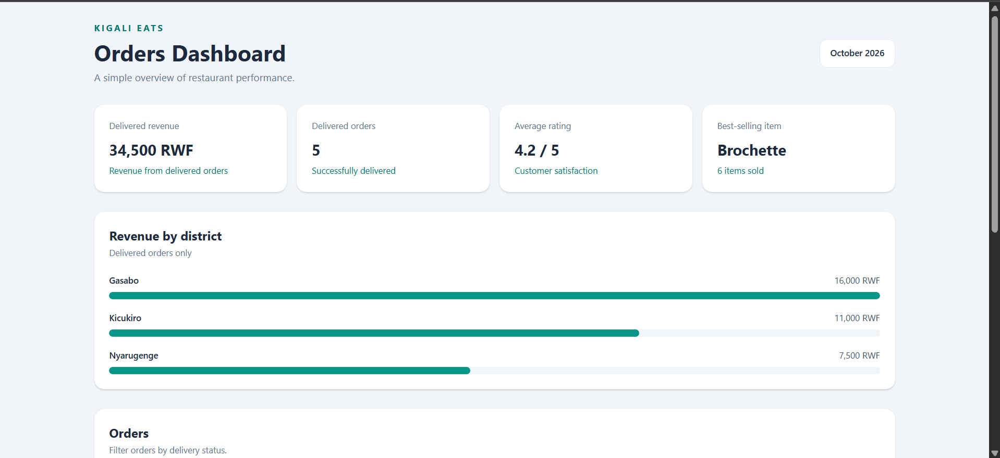

# Week 5 — Array & Object Manipulation Drills

**Course:** Advanced Frontend Web Development
**Workshop:** Array & Object Manipulation Drills

## Project Overview

This project practices modern JavaScript array and object manipulation using a Kigali Eats orders dataset.

## Workshop Exercises

- **Station 1:** `map()`, `filter()`, `find()`, `some()`, `every()`, and `Set`.
- **Station 2:** `reduce()` for totals, revenue, ratings, quantities, and status counts.
- **Station 3:** Grouping, ranking, customer summaries, and menu price lists.
- **Station 4:** Immutable updates to orders, items, districts, and prices.
- **Station 5:** Interactive dashboard built with Vite and Tailwind CSS.

## Dashboard Features

- Delivered revenue, delivered order count, average rating, and best-selling item.
- Revenue-by-district horizontal bar chart.
- Orders table with customer, district, total, and status.
- Interactive All, Delivered, Pending, and Cancelled filters.
- Responsive layout using Tailwind CSS.

## How to Run

1. Install dependencies:

   `cd dashboard`

   `npm.cmd install`

2. Start the development server:

   `npm.cmd run dev`

3. Open the local URL shown in the terminal.

## Files

- `data.js` — workshop orders dataset.
- `drills.js` — numbered JavaScript exercise solutions.
- `dashboard/` — Vite and Tailwind dashboard.
- `dashboard/src/dashboardHelpers.js` — dashboard helper functions.
## Screenshot

## Score

Workshop total: 63 points
Bonus: up to 2 points
Final score: Pending instructor review.

